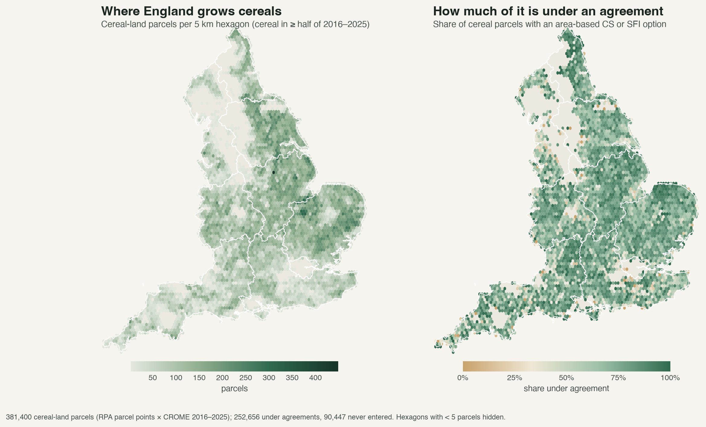

# SentiNews

**Can satellites, news and farm accounts tell us which farms are weathering climate shocks, and whether government
nature schemes help them do so?**

England's farms have had a run of hard years: dry springs, summer heat, and very wet winters. At the same time, farmers
are moving from old subsidies to new schemes that pay for looking after soil, hedges and wildlife (the Sustainable
Farming Incentive and Countryside Stewardship). This project puts together free data from space, from government
records, from company accounts and from the news to see how farmland copes with shocks, and whether land in these
schemes copes better.

*Left: where England grows cereals (wheat, barley, oats). Right: the share of that land in a Sustainable Farming
Incentive or Countryside Stewardship agreement. Each hexagon is 5 km across; no individual farm is shown.*

---

## The questions, in plain words

1. **Harvest.** Can we see a poor harvest coming from space, weeks or months before the official figures?
2. **Resilience.** Which land bounces back after a drought, and which stays stressed year after year?
3. **Nature schemes.** Does land in an agreement hold up better in a bad year than similar land that is not?

A bank funding farms has a stake in all three: they show where to call customers first, and which land may lose value.

## What is in this repository

| Folder | What it holds |
|---|---|
| [`eo-elms-resilience/`](eo-elms-resilience/) | The satellite and scheme analysis: code, results, maps. Start with its [README](eo-elms-resilience/README.md). |
| [`Documents/SentiNews_Github/CompaniesHouse/`](Documents/SentiNews_Github/CompaniesHouse/) | Balance sheets and financial resilience ratios from the published accounts of agricultural companies. |
| [`Documents/SentiNews_Github/GDELT/`](Documents/SentiNews_Github/GDELT/) | UK news articles about drought, 2021–2026, from the GDELT news archive, sorted by a language model into real droughts vs figures of speech, with type and place. |

## How the pieces fit

- **Satellites** (Sentinel-2, MODIS) show how green and healthy crops are, field by field, every couple of weeks.
- **Weather records** (ERA5-Land) show what hit each area: dry springs, hot summers, waterlogged winters.
- **Crop maps** (the government's Crop Map of England) show what was grown on every field each year.
- **Scheme records** show which fields are in an agreement, and since when.
- **Flood and peat maps** show land that is at long-term risk.
- **Company accounts and the news** add the money side and the public picture: how farm businesses' finances moved,
  and when and where droughts made the headlines.

## What we have found so far

- **A pilot with older satellites** (50 sites, 2001–2026) found that **land that had not recovered from one drought was
  hit harder by the next**. This held under every setting we tested. Whether accumulated stress slows the next
  recovery is less certain.
- **2025 and 2026 were back-to-back dry springs**, the driest in our record (rainfall 37% and 41% below normal over
  cereal areas), and summer 2026 had the most hot days.
- **Two-thirds of England's cereal land is now in an agreement**, most of it since a big wave of new agreements
  in 2024. About 90,000 cereal fields have never been in one, which gives a fair comparison group in every region.
- **About 46,000 cereal fields (12%) are in the highest flood-risk zone or on deep peat**, mostly in the Fens. These
  are the first candidates for a "land at risk" watch-list.

The main test, whether scheme land copes better, has been written down in advance
([pre-registration](eo-elms-resilience/wp3_elms_effect/results/preregistration.md)) and will run once the national
satellite extraction for 2017–2026 is complete.

## The three work packages

| | What it asks | What it produces |
|---|---|---|
| **WP1 · Harvest signal** | Can field-level satellite data predict regional yields early? | An early-warning index by region |
| **WP2 · Resilience** | How deep is each shock, and how fast does land recover? | A resilience score per field and region; a list of land at risk |
| **WP3 · Nature schemes** | Do agreements change how land responds to shocks? | The effect of agreements, by type of action and region |

## Data

Almost everything here is **free and open**: Sentinel-2 (Copernicus), MODIS (NASA), ERA5-Land (Copernicus/ECMWF),
the Crop Map of England, RPA land parcels, Natural England and Rural Payments Agency scheme layers, Defra payment
data, Environment Agency flood zones, Natural England peat maps, Companies House accounts and GDELT news.

Large files and anything that names individual farmers are **kept out of this repository**. The code downloads and
rebuilds them; only counts and maps that show no individual farm are published here.

## Running it

See [`eo-elms-resilience/README.md`](eo-elms-resilience/README.md) for the pilot and
[`eo-elms-resilience/shared/README.md`](eo-elms-resilience/shared/README.md) for the full data pipeline (Python 3.11;
Earth Engine for the national satellite extraction).

## Status

Work in progress (October 2026). The data foundation is built; the national satellite extraction is running; results
for the three work packages will follow.
