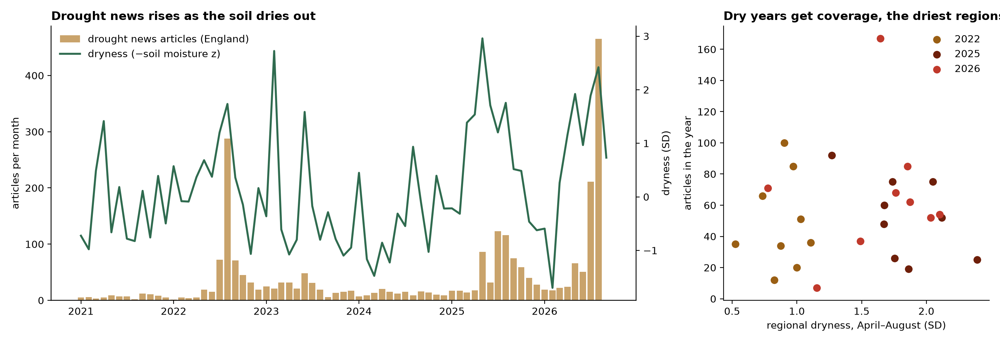

# SentiNews

**What do satellites, the news and farm accounts each tell us about how farms get through droughts, and which one
should a bank or a policymaker trust to find the farms in trouble?**

England's farms have had a run of hard years: dry springs in 2025 and 2026, summer heat, very wet winters in between.
Two kinds of evidence describe these shocks. One comes from **the land itself**: satellites that measure how green
and healthy every field is, weather records and government maps. The other comes from **people and money**: what the
news reported, and what farm companies' published accounts show. This repository brings both together.

*Left: the bars are monthly news articles about drought in England; the line is how dry the soil actually was
(ERA5-Land soil moisture, below normal = up). News rises as the soil dries out, in 2022, 2025 and 2026. Right: each
dot is one English region in one dry year. Regions that were drier did not get more coverage.*

---

## The story so far, in plain words

**The news knows when, but not where.** Drought headlines rise and fall with the weather: when soils dry out across
the country, coverage jumps in the same month. But within a dry year, the regions hit hardest do not get more
attention than the rest. The news follows the national story, not local severity.

**The land shows where.** Satellites see every field every couple of weeks, so they can show which areas are under the
most stress and which recover. A pilot with older satellites found that **land still recovering from one drought was
hit harder by the next**, a result that held under every setting we tried. The full analysis now uses Sentinel-2
images for about 380,000 cereal fields across England, 2017–2026.

**Money shows it last.** We linked the published accounts of about 2,400 farm companies to the weather their own area
had. So far there is no clear sign of drought in their balance sheets, mostly because accounts arrive late: the
accounts covering the 2025 and 2026 droughts have not been filed yet. A fairer test comes in 2027, and a bank's own
monthly data would show it much sooner.

**So, for finding the farms in trouble:** measured stress on the land beats headlines, and it arrives well before the
accounts do.

## What we can already say about the land

- **Two-thirds of England's cereal land is now in a nature-friendly farming agreement** (the Sustainable Farming
  Incentive or Countryside Stewardship), most of it from a big wave of agreements in 2024. About 90,000 cereal fields
  have never been in one, which gives a fair comparison group.
- **2025 and 2026 were the driest springs in our record** over cereal areas: rainfall 37% and 41% below normal.
- **About 46,000 cereal fields (12%) are in the highest flood-risk zone or on deep peat**, mostly in the Fens: the first
  candidates for a watch-list of land at risk of losing value.
- **The main test, whether land in an agreement copes better with drought, is written down before we look**
  ([pre-registration](eo-elms-resilience/wp3_elms_effect/results/preregistration.md)), so the answer cannot be shaped
  by the data.

## What is in this repository

| Folder | What it holds |
|---|---|
| [`eo-elms-resilience/`](eo-elms-resilience/) | **The land side**: satellite, weather, crop-map and scheme analysis, plus the code that links in the news and accounts. Start with its [README](eo-elms-resilience/README.md). |
| [`Documents/SentiNews_Github/GDELT/`](Documents/SentiNews_Github/GDELT/) | **The news side**: UK news articles about drought, 2021–2026, from the GDELT news archive, sorted by a language model into real droughts vs figures of speech, with type, place and economic impact. |
| [`Documents/SentiNews_Github/CompaniesHouse/`](Documents/SentiNews_Github/CompaniesHouse/) | **The money side**: balance sheets and financial resilience ratios from the published accounts of agricultural companies. |

## How the pieces fit

| Evidence | What it tells us | Strength | Weakness |
|---|---|---|---|
| **Satellites** (Sentinel-2, MODIS) | How healthy each field is, every couple of weeks | Every field, early, objective | Cloud gaps; needs care to interpret |
| **Weather** (ERA5-Land) | What hit each area: drought, heat, waterlogging | Defines the shock independently of the crop | About 9 km, not field level |
| **Crop and scheme maps** | What was grown where; which fields are in an agreement, since when | Exact, official | Show only agreements still running |
| **News** (GDELT) | When droughts became a public story, and what impacts were reported | Fast, rich descriptions | Follows the national story, not the worst places |
| **Accounts** (Companies House) | How farm businesses' finances moved | The money outcome a lender cares about | Yearly, late, only for companies |

## The three work packages

| | What it asks | What it produces |
|---|---|---|
| **WP1 · Harvest signal** | Can field-level satellite data predict regional yields early? | An early-warning index by region |
| **WP2 · Resilience** | How deep is each shock, and how fast does land recover? | A resilience score per field and region; a list of land at risk |
| **WP3 · Nature schemes** | Do agreements change how land responds to shocks? | The effect of agreements, by type of action and region |

## Data

Everything used is **free and open**: Sentinel-1 and Sentinel-2 (Copernicus), MODIS (NASA), ERA5-Land
(Copernicus/ECMWF), the Crop Map of England, RPA land parcels, Natural England and Rural Payments Agency scheme layers,
Defra payment data, Environment Agency flood zones, Natural England peat maps, Companies House accounts and the GDELT
news archive.

Large files and anything that names individual farmers are **kept out of this repository**. The code downloads and
rebuilds them; only counts and maps that show no individual farm are published here.

## Running it

See [`eo-elms-resilience/README.md`](eo-elms-resilience/README.md) for the pilot and
[`eo-elms-resilience/shared/README.md`](eo-elms-resilience/shared/README.md) for the full data pipeline (Python 3.11;
Earth Engine for the national satellite extraction). The news-and-accounts link is
[`eo-elms-resilience/shared/src/link_accounts_news.py`](eo-elms-resilience/shared/src/link_accounts_news.py).

## Status

Work in progress (October 2026). The data foundation is built and the national satellite extraction is running;
results for the three work packages will follow.
